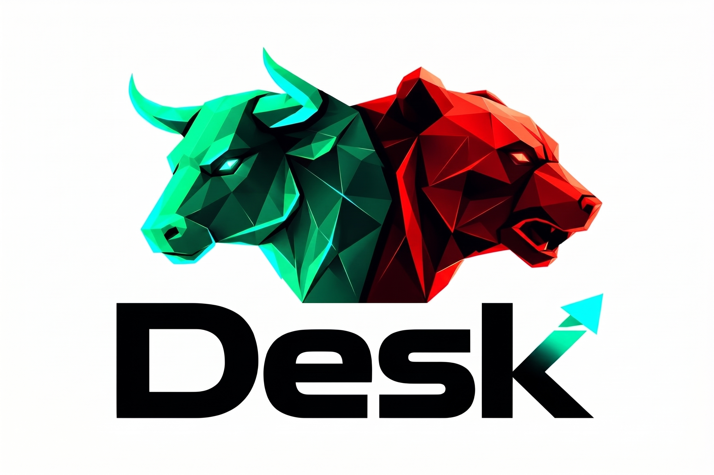

<div align="center">
  

  # Desk
  ### *Institutional Quantitative Intelligence & Systematic Execution Engine*

  [](#)
  [](https://pola.rs/)
  [](#)
  [](#)
  [-purple?style=flat)](#)
  [](https://github.com/cardchase/loomflow)

  <p align="center">
    <strong>A high-throughput quantitative engine engineered to extract verifiable mathematical edges (+EV) from live forward-looking market data.</strong>
  </p>
</div>

---

> [!NOTE]
> **🏛️ Lineage & Core Ethos**
> 
> **Desk** evolved and built upward from the high-throughput visual data engineering foundation of [cardchase/loomflow](https://github.com/cardchase/loomflow). 
> 
> While Loomflow provided the enterprise visual ETL framework, **Desk** transforms that computational backbone into a dedicated **Quantitative Intelligence & Systematic Edge Discovery Engine**. 
>
> The sole ethos of Desk is **finding true mathematical edge in noisy, forward-looking market streams**—identifying empirical pricing discrepancies where bookmaker or market consensus diverges from predictive statistical reality, and translating that discrepancy into strictly guarded, positive expected value ($+EV$) execution cards.

---

## 🧭 Multi-Domain Intelligence Architecture

Desk is designed as an asset-agnostic quantitative workbench. It currently runs active production intelligence across global sports markets, with financial and forward asset modeling in active development.

```
                                      ┌──────────────────────────────────────────────┐
                                      │                     DESK                     │
                                      │   Institutional Quantitative Engine          │
                                      └──────────────────────┬───────────────────────┘
                                                             │
                    ┌────────────────────────────────────────┼────────────────────────────────────────┐
                    │                                        │                                        │
                    ▼                                        ▼                                        ▼
   ┌─────────────────────────────────┐      ┌─────────────────────────────────┐      ┌─────────────────────────────────┐
   │       🏀 BASKETBALL (NBA)       │      │        ⚽ SOCCER (GLOBAL)       │      │   📈 FINANCIALS & MARKETS (DEV) │
   │  - Full Market Splits           │      │  - 75,000+ Historical Matches   │      │  - Systematic Order Flow        │
   │  - FT, 1H, 2H, Q1-Q4            │      │  - 50+ Countries & Leagues      │      │  - Forward Curve Imbalances     │
   │  - Dual Pace Regressors         │      │  - 1X2, OU (0.5-5.5), BTTS      │      │  - Volatility Spread Arbitrage  │
   │  - Dynamic Elo Power Curves     │      │  - Resilient Auto-Resume State  │      │  - Real-Time Quant Indicators   │
   └─────────────────────────────────┘      └─────────────────────────────────┘      └─────────────────────────────────┘
```

---

## 🏀 Basketball (NBA) Systematic Edge Suite

The NBA module provides end-to-end coverage: from 10-worker concurrent odds ingestion, to rolling feature engineering, to dual machine learning regression, culminating in actionable daily betting cards.

### 1. Market Coverage
* **Moneyline (Home / Away 2-Way)**: Full Time (inc. OT), 1st Half, 2nd Half, 1st Quarter, 2nd Quarter, 3rd Quarter, 4th Quarter.
* **Over / Under Totals**: Full Time (inc. OT), 1st Half, 2nd Half, 1st Quarter, 2nd Quarter, 3rd Quarter, 4th Quarter.
* **Target Line Priority**: Dynamically isolates Bet365 balanced lines (~`1.91`/`1.91`) with fallback to sharp consensus (Pinnacle/888sport).

### 2. The Core Mathematical Models
1. **Dynamic Elo Rating Engine**:
   - Calculates custom game-by-game team power ratings with a tuned $K=20.0$ and Home Advantage offset of $+70.0$ Elo points.
   - Automatically applies **25% inter-season regression** to account for off-season roster turnover and reversion to the league mean.
   $$P(\text{Home Win}) = \frac{1}{1 + 10^{(R_{\text{Away}} - (R_{\text{Home}} + 70)) / 400}}$$

2. **Dual 50/50 Total Point Regressors**:
   - **Model A (Pure Pace Regressor)**: Uses strictly team-level rolling metrics (offensive/defensive efficiency, recent 5-game & 15-game pace, rest days, back-to-backs) completely blind to market odds.
   - **Model B (Market Residual Regressor)**: Predicts the delta between the bookmaker's posted line and the true outcome ($\text{Actual} - \text{Line}$).
   - **The Blend**: Combines both models 50/50 to eliminate anchoring bias while respecting sharp market consensus.
   $$\hat{y}_{\text{projected}} = \frac{1}{2} \hat{y}_{\text{pure}} + \frac{1}{2} \left(\text{Line}_{\text{market}} + \hat{r}_{\text{residual}}\right)$$

3. **Strict Tie Filtering**:
   - Because derivative markets (1st Half, 1st Quarter) feature three outcomes (Home, Away, Tie), training data strictly eliminates tie games from binary logistic classifiers to prevent probability distortion.

4. **Quantitative Edge & Fractional Kelly Sizing**:
   - Computes Expected Value against bookmaker decimal odds:
   $$\text{EV}\% = \left(P_{\text{model}} \times \text{Odds}_{\text{decimal}}\right) - 1.0$$
   - Allocates risk according to a conservative quarter-Kelly criterion with a 2.0u–5.0u hard cap.

5. **Guardrail Metrics**:
   - **`Min_Playable_Odds`**: Calculates the mathematical floor below which the bet must be passed to protect against margin erosion (ensures a minimum $+2.0\%$ edge buffer).
   - **`Play_To_Line`**: Evaluates total distribution standard deviation ($\sigma \approx 13.5$ pts for FT, $8.5$ pts for 1H) and computes the exact total line cutoff maintaining a $53.0\%$ win rate threshold.
   - **Reverse Line Movement (Steam / Injury Alert)**: If an odds line drifts higher by $\ge +0.15$ on your betting app compared to opening/scraped lines, Desk triggers an immediate alert to pause betting until official starting lineups confirm.

---

## ⚽ Soccer (Global Football) Historical Warehouse

Desk houses a massive-scale, high-concurrency client-side V8 extraction engine for international soccer:

* **Over 75,000+ Completed Matches** across 50+ countries and global leagues (Premier League, La Liga, Serie A, Bundesliga, Champions League, Copa Libertadores, A-League, and regional divisions).
* **Granular Score Timelines**: Full Time (FT), Half Time (HT), Second Half (SH), Extra Time (ET), and Penalty shootouts.
* **Full Market Matrix**:
  * 1X2 Match Winner (FT, 1H, 2H)
  * Over/Under Totals (`0.5`, `1.5`, `2.5`, `3.5`, `4.5`, `5.5`)
  * Both Teams to Score (BTTS: Yes / No)
  * Double Chance (1X, 12, X2)
  * Draw No Bet (DNB)
* **Resilient State Persistence**: Auto-resuming state machine (`soccer_historical_state.json`) that recovers flawlessly across network disconnects, browser restarts, and anti-scraping challenges.

---

## 🚀 Execution & Performance Engineering

Desk is built for sub-second vector processing and high-concurrency client-side crawling:

* **10-Worker Browser Pool**: Uses Playwright with stealth evasions and an `asyncio.Semaphore(10)` worker pool. Scrapes 30+ upcoming matches with 14 markets per match in **under 2 minutes**.
* **Zero Data-Loss Incremental Persistence**: Real-time async write locks (`save_lock`) ensure that as each individual fixture finishes scraping, it immediately flushes to disk. You can open and inspect [`upcoming_games.csv`](file:///sports/basketball/nba/data/upcoming_games.csv) live while the scraper runs.
* **In-Memory Vector Analytics**: Powered by Rust-based [Polars](https://pola.rs/) DataFrames for millisecond feature computations across multi-gigabyte historical sets.

---

## 📁 Repository Structure

```
Desk/
│
├── desk_logo.jpg                          <- Official Project Identity
├── README.md                              <- Institutional Architecture & Documentation
├── requirements.txt                       <- Python Core Dependencies
│
├── sports/
│   ├── basketball/
│   │   └── nba/
│   │       ├── data/
│   │       │   ├── nba_historical.csv                 <- Master Training Base (10,000+ matches)
│   │       │   ├── upcoming_games.csv                 <- Fresh live odds & fixture slate
│   │       │   ├── actionable_betting_checklist.csv   <- EXECUTIVE DELIVERABLE (Top high-edge picks)
│   │       │   └── weekly_betting_card.csv            <- Complete multi-market quantitative card
│   │       └── scripts/
│   │           ├── run_nba_predictions.py             <- Unified Command Center / Daily Entrypoint
│   │           ├── nba_master_predictor.py            <- Machine learning engine & math core
│   │           ├── basketball_upcoming.py             <- Live odds extractor (10 concurrent workers)
│   │           ├── update_nba_history.py              <- Incremental historical updater
│   │           ├── basketball_historical.py           <- Full-season historical archive scraper
│   │           └── README.md                          <- NBA Technical Manual & Math Documentation
│   │
│   └── soccer/
│       ├── data/
│       │   ├── soccer_historical.csv                  <- Global Historical Warehouse (75,000+ matches)
│       │   └── soccer_historical_state.json          <- Fault-tolerant crawler state tracker
│       └── scripts/
│           ├── soccer_historical.py                   <- High-throughput global soccer scraper
│           └── soccer_upcoming.py                     <- Upcoming fixture & multi-market extractor
│
└── archive/                               <- Legacy scripts, prototypes & exploratory data
```

---

## ⚡ Quickstart Manual

### 1. Installation
Clone the repository and install the required dependencies:
```bash
git clone https://github.com/cardchase/Desk.git
cd Desk
pip install -r requirements.txt
playwright install chromium
```

### 2. Daily NBA Edge Extraction & Prediction
Run the unified command center with a single command. This automatically scrapes live odds with 10 concurrent browser workers and computes the day's highest-edge plays:

```bash
# Automated run: Scrapes live odds with concurrency=10, then executes predictive models
python sports/basketball/nba/scripts/run_nba_predictions.py --scrape

# Or run the master predictor directly with live scraping:
python sports/basketball/nba/scripts/nba_master_predictor.py --scrape
```

To run predictions instantly against previously scraped odds:
```bash
python sports/basketball/nba/scripts/run_nba_predictions.py --all --no-scrape
```

### 3. Reviewing Executive Deliverables
Open [`sports/basketball/nba/data/actionable_betting_checklist.csv`](file:///sports/basketball/nba/data/actionable_betting_checklist.csv) in Excel or Google Sheets. The checklist outputs:
1. **Matchup & Market** (e.g. `FT_OU`, `1H_OU`, `Moneyline`)
2. **Recommended Pick** & Current Market Odds
3. **Model Projected Total / Probability**
4. **`Min_Playable_Odds`**: Guardrail floor odds.
5. **`Play_To_Line`**: Cutoff threshold if the line moves.
6. **`Rec_Units`**: Exact mathematical stake allocation.

### 4. Updating Historical Training Archives
Once or twice weekly, append newly completed games to the training base:
```bash
python sports/basketball/nba/scripts/update_nba_history.py
```

---

## 🔬 Technical Philosophy & Disclaimer

**Desk is a personal quantitative research lab and systematic edge exploration workbench.**

* It is maintained primarily for private research, mathematical modeling, and hobbyist edge discovery.
* The repository is public on GitHub in the spirit of open science, reproducibility, and modern software craft.
* **Disclaimer**: All models, projections, and recommendations are mathematical outputs intended for quantitative study. Desk does not offer financial or gambling advice. Always practice strict bankroll management.

---

<div align="center">
  <sub>Engineered by <strong>cardchase</strong> • Co-developed with Advanced Agentic AI • Evolved from Loomflow</sub>
</div>